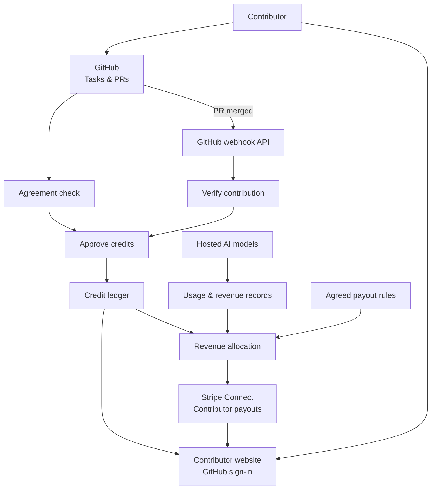

# Contributor Platform — proposed architecture

GitHub handles project issues, forks, pull requests and code review. The Contributor Platform records approved credits, shows contributor balances, and later calculates agreed revenue shares from hosted models.

## System diagram

## Components

- **GitHub:** Contributors select tasks, submit pull requests and have work reviewed.
- **Agreement check:** Record acceptance against a contributor's stable GitHub identity.
- **Webhook API:** Receive merged-PR events and verify the repository, contributor and contribution.
- **Credit approval:** Authorised reviewers approve the credits and attribution for accepted work.
- **Credit ledger:** Record credits per contributor, project and pull request; prevent duplicates and retain corrections.
- **Contributor website:** Sign in with GitHub to view credit balances, contribution history and, when available, revenue allocations and payment history.
- **Usage and revenue accounting:** Track income earned by each hosted model and the approved amount available for contributor sharing.
- **Revenue allocation:** Calculate each eligible contributor's share from their approved project credits and the project's agreed revenue-sharing rules.
- **Stripe Connect payouts:** Distribute approved payments to eligible contributors when commercial revenue and agreed payment terms are in place.

## First deliverable

A merged test PR leads to one approved credit record and a balance visible on the contributor website. Repeated webhook deliveries do not duplicate credits.

Hosting, inference and customer billing are to be decided by the group.

## Implementation issues

- [Agreement flow #2](https://github.com/Community-AI-Lab/platform/issues/2)
- [Credit ledger #3](https://github.com/Community-AI-Lab/platform/issues/3)
- [Contributor website #4](https://github.com/Community-AI-Lab/platform/issues/4)
- [Revenue allocation and payouts #8](https://github.com/Community-AI-Lab/platform/issues/8)
- [GitHub webhook API #19](https://github.com/Community-AI-Lab/platform/issues/19)
- [Credit approval #20](https://github.com/Community-AI-Lab/platform/issues/20)
