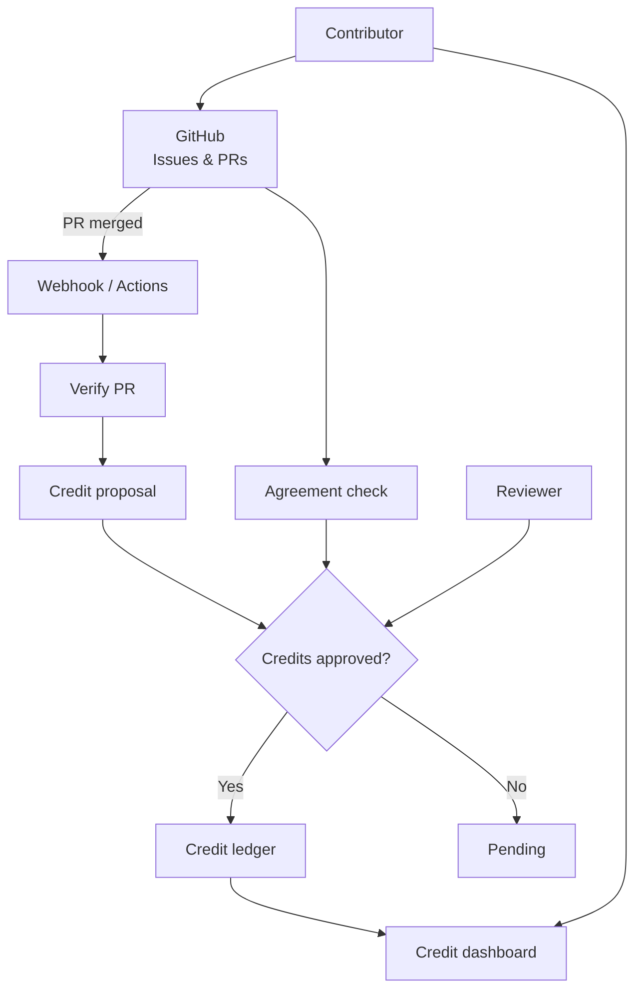

# Contributor Platform — GitHub-first architecture (proposal)

**Status:** proposed architecture only. No credit system, backend or website is deployed by this document.

## Goal

Let people do the actual work in GitHub, acknowledge an approved contributor agreement, and receive a durable, verifiable, **provisional participation credit** for accepted contributions. Credits have **no cash value, ownership rights or royalty entitlement** unless a later, legally agreed scheme expressly provides them.

**Scope:** GitHub manages issues, forks, commits, pull requests and code review. We do **not** rebuild GitHub's task management.

## System diagram

## Responsibilities

| Part | What it does | First phase |
| --- | --- | --- |
| GitHub | Contributor identity, issues, forks, PRs, reviews and merges | Already available |
| Agreement gate | Associate immutable version/hash and acceptance evidence with stable GitHub user ID; block awards if required terms not accepted | Existing PR acknowledgement is **only a draft test**, not a live commercial licence. See [issue #2](../issues/2) |
| Event intake | Receive merged-PR events, verify GitHub webhook HMAC, ignore untrusted payloads and reconcile against GitHub API | Proposed; no service deployed |
| Award review | Determine project-specific credit amount and attribution with explicit approval; a merge alone does not assign credits | Proposed |
| Ledger | Append award and correction events; use a unique award ID and stable numeric GitHub user ID; reject duplicate project/repo/PR/contributor award keys | Proposed; Git version history is auditable but **not immutable** |
| Credit website | Show contributor/project totals, award history, evidence links and provisional status, without editing records | Proposed read-only GitHub Pages site |
| Revenue / blockchain | No payments, minting, tokens or gas fees. Preserve stable evidence for later export | Out of scope |

## Accepted contribution → award

1. Contributor uses GitHub to select work and submit a PR; the draft acknowledgement workflow must not be mistaken for a legally effective contributor agreement.
2. A PR is merged after normal code review. GitHub sends an event; the server verifies its signature and uses the GitHub API to recheck the final merge state and source repository.
3. The service constructs a *proposed* award linked to the project, repository, PR ID, merge commit SHA, stable numeric GitHub user ID, and any credited coauthors. It does **not** auto-credit every commit or merge.
4. An authorised reviewer approves the attribution, score and evidence under published rules. Missing agreement evidence, ambiguity or disputes put the award on hold.
5. A unique award record is added through a protected, reviewed change to the credit ledger. Subsequent adjustments use **new reversal/correction events**, not edits to historical award events.
6. The read-only site builds project totals and links each balance to the PR and approval record.

## Minimal ledger event fields

`event_id`, `event_type` (award/reversal/correction), `project_id`, `github_user_id`, `github_login_at_award`, `repository`, `pr_number`, `merge_commit_sha`, `evidence_url`, `credits_delta`, `reviewer_github_user_id`, `approved_at`, `agreement_version_or_status`, `supersedes_event_id` (when applicable).

A signed-in user can later have a private personal view via GitHub OAuth, but a **public, read-only** GitHub Pages page is sufficient for the first proof of concept. Never publish personal identity documents, private agreement receipts, API tokens, passwords or other sensitive data in a public ledger.

## Zero-cash-cost constraint

- No production blockchain, smart contracts, gas fees, paid database or paid hosting in the first phase.
- The architecture describes a webhook receiver as desired. A hosted receiver may need a free tier with usage limits; **zero cost is not guaranteed**. For the initial demo, a GitHub Actions event handler can replace the external receiver if no free, secure host is suitable.
- GitHub Actions/Pages availability and quotas must be checked before activating; avoid a permanent paid service.
- Git history alone is not a permanent independent ownership registry: repo admins can rewrite history. Restrict changes, use reviewed/protected branches and independently retained signed backups when a trusted record is required.

## First demonstration and success criteria

A second GitHub account submits a harmless PR → a maintainer merges it → a separate authorised award of **100 test credits** is approved → one ledger event is recorded → the public website shows exactly 100 provisional credits linked to that PR. Replaying the event adds **zero** extra credits. A later correction remains traceable. This is a test, not evidence of financial entitlement.

## Related / next issues

- Existing: [Contributor journey #1](https://github.com/Community-AI-Lab/platform/issues/1), [agreement flow #2](https://github.com/Community-AI-Lab/platform/issues/2), [credit ledger #3](https://github.com/Community-AI-Lab/platform/issues/3), [dashboard #4](https://github.com/Community-AI-Lab/platform/issues/4).
- Add: secured GitHub event intake; credit approval rules and attribution; ledger integrity/reconciliation test if not covered by #3.

**Deliberately excluded from this first phase:** duplicating GitHub Issues, blockchain deployment, NFT issuance, revenue sharing, actual royalties, model hosting, GPU scheduling, audio upload and paid services. These can remain future separate milestones.
