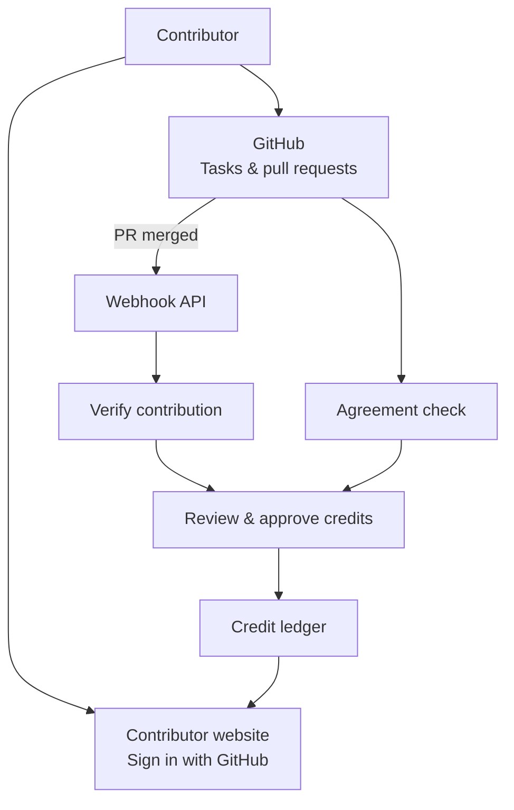

# Contributor Platform — proposed architecture

GitHub handles project issues, forks, pull requests and code review. The Contributor Platform links accepted contributions to credit records and gives contributors a website to view their credits.

## System diagram

## Components

- **GitHub:** Contributors select tasks, submit pull requests and have their work reviewed.
- **Agreement check:** Link a contributor's GitHub identity to acceptance of the approved agreement.
- **Webhook API:** Receive merged-PR events and verify the repository, contributor and contribution.
- **Credit approval:** Authorised reviewers determine and approve credits for accepted work.
- **Credit ledger:** Record credits against the contributor, project and pull request. Prevent duplicate awards and preserve correction history.
- **Contributor website:** Sign in with GitHub to view your credit total, projects and linked contribution history.

## First deliverable

A contributor merges a test pull request. A reviewer approves a credit award. The ledger records the award, and the contributor sees the credits on the website. Repeating the webhook event does not issue credits twice.

## Implementation issues

- [Agreement flow #2](https://github.com/Community-AI-Lab/platform/issues/2)
- [Credit ledger #3](https://github.com/Community-AI-Lab/platform/issues/3)
- [Contributor website #4](https://github.com/Community-AI-Lab/platform/issues/4)
- [GitHub webhook API #19](https://github.com/Community-AI-Lab/platform/issues/19)
- [Credit approval #20](https://github.com/Community-AI-Lab/platform/issues/20)
